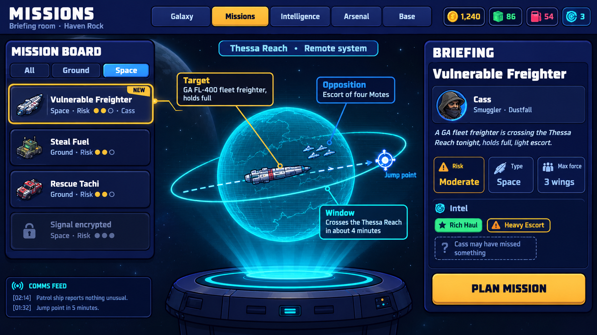

# Star Rebellion: HUD mock-up review log

The designer is generating the eight screens from the ChatGPT mock-up prompts (in the Claude project as `SR-HUD-MOCKUP-PROMPT.md`) in ChatGPT, a couple a day. Each screen is
reviewed here as it arrives: what to adopt, what to correct in the build (without spending another image on it), and
where it lands. When all eight are in, this log becomes the K7 handoff (the HUD layout pass), and the K6 parts feed
`docs/ARENA-HC35-FEEDBACK-1.md` §3.6.

| # | Screen | Received | Feeds |
|---|---|---|---|
| 1 | The mission board | 20 Oct | K6 (§3.6, the Missions tab mock) |
| 2–5 | Planning windows 1–4 | — | K6 (the holographic windows), K7 (their final style) |
| 6 | The mission HUD | — | K7 |
| 7 | The visual-language sheet | — | K3, K4, K5 (reference), K7 |
| 8 | The debrief | — | K7 |

---

## Screen 1: the mission board (20 October)

File: `docs/ui/mockups/hc35-01-mission-board.png`.

**Verdict: adopt it as the target for the K6 Missions tab mock**, with the corrections below. It keeps the vanilla
briefing room's three-part structure (board, holo-table, briefing rail) and makes the opportunity readable at a
glance. That was the job.

### Adopt

- **The layout:** the 330 px board on the left, the holo-table centre, and the briefing rail on the right that fits
  without scrolling. The comms feed sits bottom left under the board.
- **The holo-table** tells the whole opportunity in one picture: the freighter on its dashed lane, the escort group,
  the jump point at the lane's end, and three callouts with leader lines (Target, Opposition, Window). The projector
  pedestal and beam make the "holographic" idea concrete, so the planning windows should rise out of this same beam.
- **The selected card's connector:** a gold line from the selected card into the projection, as the vanilla spec says.
- **The fact tiles** (Risk, Type, Max force), each with an icon above its label and value.
- **The Intel block:** good modifiers as green tags, bad as orange, and the dashed "? Cass may have missed something"
  tag for what the Source didn't see. This is the right way to show hidden modifiers without revealing them.
- **The mission thumbnails on the board cards.** These are richer than the vanilla type-icon box, and better for it:
  each card shows its target or vehicle. Draw them from `SR_ART`, not as images (see the corrections).
- **Type and colour:** Bungee titles, Exo 2 body, ink-outlined chunky panels, and one gold primary (*Plan mission*)
  bottom right. All on spec.

### Correct in the build (don't regenerate)

| What the mock-up shows | Build it as | Why |
|---|---|---|
| The freighter (card thumbnail and holo) is white with **red** stripes | The FL-400 in its `heg` livery (`SR_ART.ship('gafreighter', …, {livery:'heg', sized:true})`): grey, navy bands | Red means ours. A Hegemony freighter in red stripes reads as a rebel ship |
| The escort group is white ship sprites | Hegemony-blue triangles (the vanilla space holo's threat marker), one per known escort | Blue means theirs; the count must match the known modifiers |
| The jump point is a cyan and white target | A Hegemony-blue jump marker | It's the enemy's exit; cyan is reserved for info and the projector |
| The **Target** callout is gold | Cyan (the vanilla callout colour), with the Opposition callout staying blue | Gold means "you can act on this". Only *Plan mission* may be gold on this screen |
| The locked card shows grey risk pips ("●●●") | No pips: "Signal encrypted" and a lock only | A locked mission's risk is unknown |
| The board thumbnails are a truck, a red jeep, a freighter | The opportunity's card draws the FL-400 (`heg`) from the art kit on a dark well. The dimmed placeholder cards ("Not in this demo") keep the vanilla type icon (soldier or ship) | Use our art, not invented vehicles. A full thumbnail set for the campaign's missions is logged for the designer |
| — (missing) | **Dig deeper** with its Intel pips, under the Intel tags; a **New opportunity** ghost button at the foot of the board | Both are in the K6 spec and the prompt didn't ask for them |
| — (missing) | The top bar's tabs are inert in the Arena, each tipped "Not in the Arena" | §3.6 |

### Open for the designer

- **The planet is very saturated.** On the holo-table that's fine (it's the projection, cyan by law). Keep the
  in-mission planet dim, as the Space FX guide says. Confirm that difference is intended.
- **The Risk tile is gold-outlined**, because Moderate risk's colour is gold in the vanilla risk palette. That's a
  second gold element next to the primary. Keep it, or switch the risk palette's middle colour to the kit's
  `--sr-c-warn` orange?
